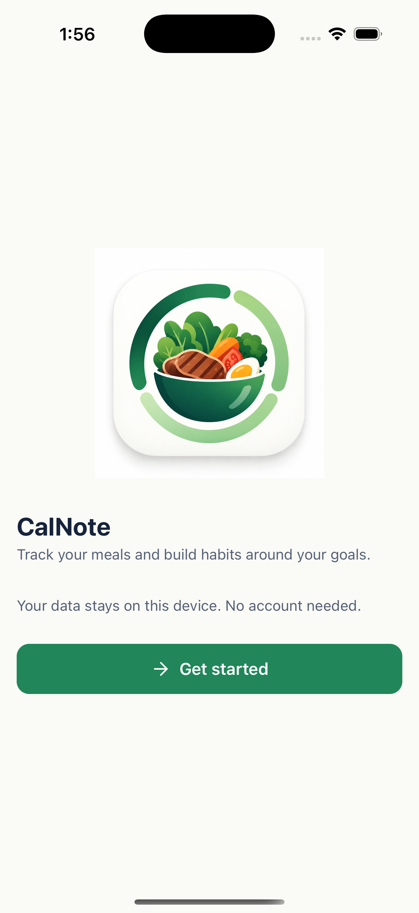
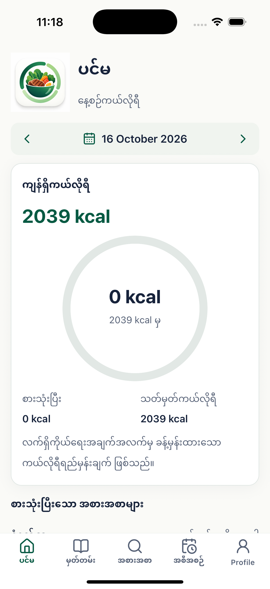
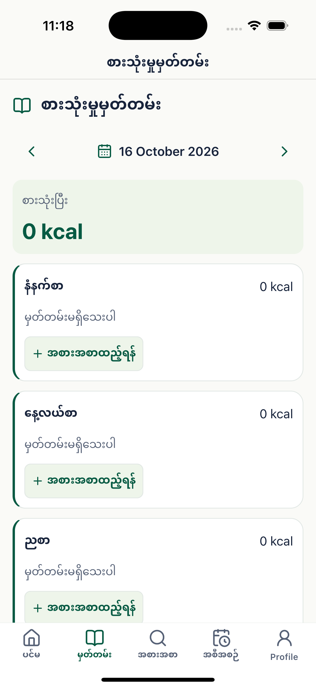
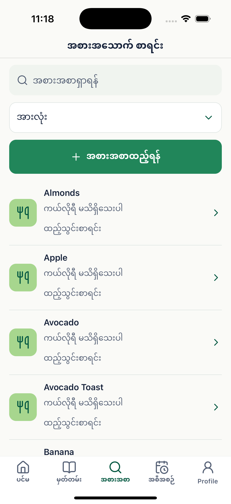
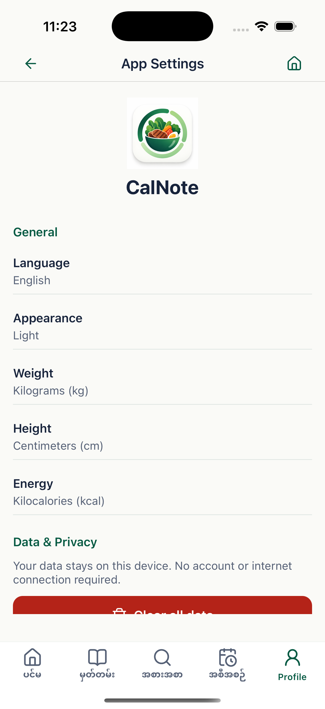

# CalNote

> [!NOTE]
> **Personal Learning Project** — CalNote is an AI-assisted development project built for learning, practice, and experimentation. It is not intended for medical or professional nutrition advice.

A simple iOS calorie-tracking app built with **React Native, Expo, and TypeScript**.

Track daily calories, manage food entries, plan meals, and monitor weight progress. All data is stored locally using SQLite. No account or internet connection is required for core features.

## Features

- **Calorie Dashboard** — Track daily calorie goals, consumption, and remaining calories.
- **Food Library** — Search foods and add custom food entries.
- **Food Diary** — Log breakfast, lunch, dinner, and snacks.
- **Meal Planning** — Plan future meals and mark them as eaten.
- **Weight & Calorie History** — View progress with charts and summaries.
- **Personalized Goals** — Calculate calorie targets based on your profile and activity level.

## Screenshots

<p>
  
  
  
  
  
</p>

## Tech Stack

- React Native & Expo
- TypeScript
- Expo Router
- SQLite

## Getting Started

Requires Node.js 24+ and npm.

```bash
npm ci
npm start
```

Run on an iOS simulator (requires Xcode):

```bash
npm run ios
```

## Testing

```bash
npm run typecheck
npm run lint
npm test
```

## Notes

- Designed for iPhone.
- Works offline for core features.
- Calorie calculations are estimates, not medical advice.
- Live online food search is not yet available.

## Expo

[View CalNote on Expo](https://expo.dev/accounts/kyi-july/projects/calories-counter)

## Documentation

- [Food catalog and Myanmar UI](FOOD_CATALOG.md)
- [Design system](DESIGN_SYSTEM.md)
- [Navigation](NAVIGATION.md)
- [Validation and device checks](VALIDATION.md)

## License

No license specified.
